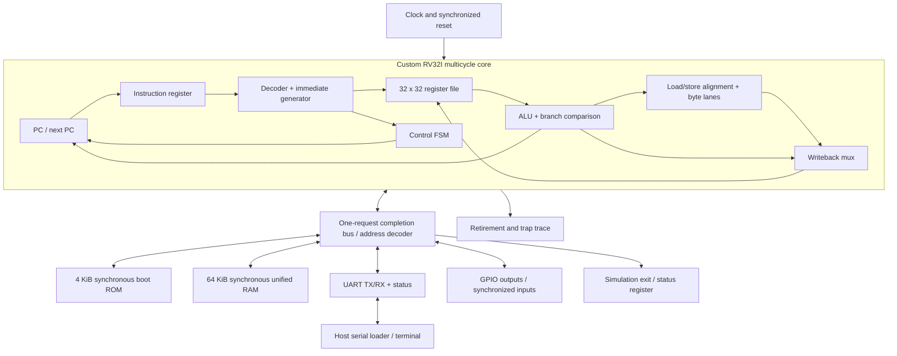

# Initial architecture contract

This is the proposed M1–M6 design, not a claim that the CPU is implemented.
Freeze these interfaces before integrating modules. Microarchitecture may change
later while keeping the software-visible contract.

## ISA and execution environment

Implement all **RV32I 2.1** instruction families, little-endian, XLEN=32,
ILP32 ABI, x0 hardwired zero, and IALIGN=32. No M/A/C/F/D, no Zicsr or Zifencei
in the baseline. Do not call an ADDI/branch subset a complete RV32I CPU.

The initial execution environment is a single hart with no interrupt delivery.
Illegal instructions, access faults, misaligned accesses, ECALL and EBREAK
produce a terminal trap record (`cause`, instruction PC, relevant address or
instruction) and halt. This defines the project's simple EEI. It is not a
complete machine-mode privileged implementation: `mstatus`, `mtvec`, `mepc`,
`mcause`, CSR instructions and `mret` belong to a later extension. A trap is not
a successful program exit. The official unprivileged base permits a simple
implementation to trap SYSTEM instructions; privilege behavior is specified
separately in the [RISC-V manuals](07-references.md).

Aligned loads/stores are mandatory. Misaligned halfword/word accesses trap
before any memory or I/O side effect. Fetch and taken branch/jump targets must
be 4-byte aligned. An untaken branch does not trap for its hypothetical target.

## Multicycle first

A multicycle FSM naturally tolerates synchronous FPGA block RAM and variable
peripheral latency. A textbook single-cycle datapath with combinational memory
is a useful drawing exercise, but forcing its read semantics into BRAM later
causes a redesign. Start with one instruction in flight and one shared bus.



The initial states are RESET, FETCH, DECODE, EXECUTE, MEMORY and WRITEBACK,
plus TRAP. FETCH and MEMORY hold until the transaction completes. Latch
`instruction_pc`, instruction, operand values, effective address and pending
result as necessary. An arithmetic instruction skips MEMORY. A branch retires
without a register write. A load retires only after its read response. A store
retires only after its write is acknowledged. A bus error suppresses retirement
and register writes and creates a trap event. Record traps separately from
successful retirements, mapping them to RVFI trap events if RVFI is added later.

PC is reset to ROM address 0 in the final SoC. M2 may parameterize reset PC to
RAM base 0x10000 for preloaded assembly tests. Never advance PC on a wait cycle;
keep the current instruction's PC distinct from the already computed next PC.

## Module responsibilities

| Module | Contract |
| --- | --- |
| `alu.sv` | ADD/SUB, AND/OR/XOR, SLL/SRL/SRA, SLT/SLTU; shifts use only low 5 bits; 32-bit wraparound |
| `regfile.sv` | Two combinational reads, one rising-edge write; synchronous reset overrides write; x0 reads always zero |
| `immediate.sv` | I/S/B/U/J reconstruction and sign extension; B/J byte offsets include the low zero; NONE returns zero |
| `decoder.sv` | Validate all RV32I instruction families; explicit operand/memory/branch/system controls; neutral illegal outputs |
| `core.sv` | PC/instruction registers, FSM, operand/result latches, bus control, writeback, trap and trace |
| `lsu.sv` | Alignment, store masks and lane placement, load extraction and sign/zero extension |
| `interconnect.sv` | Exact address selection, completion/error routing, unmapped access fault |
| `bram.sv` / `boot_rom.sv` | Clocked reads, bounded indexes, RAM write enables per byte; ROM writes error |
| `uart.sv` | Polling registers, TX serialization, synchronized RX and framing/overrun reporting |
| `gpio.sv` | Registered outputs and synchronized inputs; no clock generation |
| `soc.sv` | Address map and integration, no board pin assumptions |
| `ulx3s_top.sv` | Board clock/reset/pins only, later |

Reset control state and valid bits explicitly. Either reset x1–x31 in a small
flop-based register file for reproducible tests or deliberately treat them as
unspecified before software writes; choose and test one policy. Baseline choice:
synchronous reset clears x1–x31 while x0 is always zero. The implemented bank
has 992 physical storage bits; see [the register-file contract](09-register-file.md)
for same-address read/write timing and verification.
The implemented [immediate generator](10-immediate-generator.md) takes an explicit
format selector; legality and target alignment remain decoder/core responsibilities.
The [implemented decoder](11-instruction-decoder.md) supplies format, ALU and
memory controls. Actual commits/requests remain gated by the future core FSM.
Do not reset every BRAM word with a loop; it can prevent BRAM inference.

## Bus protocol: valid held until completion

Use a deliberately small nonstandard internal interface before considering AXI:

```text
master -> slave: valid, addr[31:0], wdata[31:0], wstrb[3:0], instr
slave  -> master: ready, rdata[31:0], error
```

`addr` is word-aligned. `wstrb=0` means read; nonzero means write. The LSU retains
the original byte address and size for alignment and load extraction. `instr=1`
marks instruction reads. A transaction completes on a rising edge where
`valid && ready`; `rdata/error` are meaningful then. `ready` includes response
completion, **not** separate request acceptance. The master keeps all request
fields stable until completion and deasserts valid or presents a new transaction
afterward. The slave must apply a store or pop a UART byte exactly once per
completed transaction, including when the master waited multiple cycles.
An error completes the request with no write/pop side effect. Reset abandons
pending work. Define this in assertions and test random waits before adding RAM.

No instruction fetch from MMIO, no simultaneous fetch and data requests, no
prefetch, caches, speculation or write buffer. Blocking transactions and single
instruction ordering permit ordinary `FENCE` as an ordering-preserving no-op.
`FENCE.I` is a separate extension; do not accidentally decode it as FENCE.
The boot EEI guarantees newly loaded RAM is visible to subsequent instruction
fetches because no stale instruction storage exists. Adding prefetch/caches
requires revisiting instruction synchronization, usually implementing Zifencei.

## Memory map

| Byte addresses (inclusive) | Size | Purpose |
| --- | --- | --- |
| `0x00000000–0x00000fff` | 4 KiB | Boot ROM, reset vector 0; executable/read only |
| `0x00010000–0x0001ffff` | 64 KiB | Unified on-chip RAM, program entry normally 0x10000 |
| `0x10000000–0x1000000f` | 16 B | UART registers |
| `0x10001000–0x10001007` | 8 B | GPIO registers |
| `0x10002000–0x10002003` | 4 B | Exit/status register, simulator terminates on a word write |
| Everything else | — | Access fault; never alias by truncating addresses |

The initial application linker reserves RAM `0x1f000–0x1ffff` for a 4 KiB
downward-growing stack, SP initially 0x20000 (16-byte aligned). Application
loadable segments must stay below 0x1f000. BSS/optional heap grow upward below
that reservation; heap ends at 0x1f000. No malloc is supplied initially. Boot ROM
uses the reserved stack during loading, so the loader rejects writes into it;
it transfers control without returning and `_start` resets SP. Stack overflow
is not hardware-protected; use canaries/high-water checks and small programs.

| Register | Access | Meaning |
| --- | --- | --- |
| UART +0 DATA | byte read/write, lane 0 | Read consumes one available RX byte; write enqueues one TX byte |
| UART +4 STATUS | word read | bit0 TX ready; bit1 RX valid; bit2 sticky RX overrun; bit3 sticky framing error |
| UART +8 ERR_CLEAR | word write | write-one-to-clear bits2/3; reserved bits ignored |
| UART +12 | — | Reserved, access fault |
| GPIO +0 OUT | word read/write | bits7:0 drive LEDs; byte strobes honored |
| GPIO +4 IN | word read | synchronized buttons/input values |
| EXIT +0 | word write | zero means pass; nonzero means program failure; FPGA latches status without stopping clock |

An empty UART read or full UART write completes without consuming/enqueuing
data; software must poll STATUS first. There is one bus master, so polling
followed by access is sufficient; RX errors require handling in the loader.
Use `volatile` MMIO pointers in C. UART uses fixed 115200 baud, 8-N-1 initially.
All unsupported register widths, masks and offsets must have defined error
behavior; do not let a byte access affect an unrelated register.

## Nonnegotiable architectural corner cases

JAL/JALR write the original PC+4; AUIPC adds its immediate to the instruction PC.
JALR uses the **old** rs1 value even when rd=rs1, clears target bit0, then checks
4-byte alignment. Signed comparisons and SRA use explicit signed operands;
SLTU/BLTU use unsigned operands. LB/LH sign-extend while LBU/LHU zero-extend.
Stores select the correct little-endian byte lanes. Loads to x0 still cause
memory/I/O accesses and faults. Avoid side effects before legality/alignment is
known. These cases each need an independent directed test.
