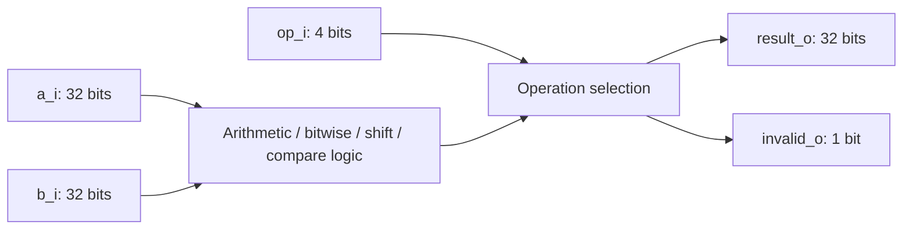

# M1, step 1: the 32-bit ALU

The first CPU module is implemented in `rtl/core/alu.sv`. It is original,
small synthesizable RTL, with no existing processor IP. This step supplies
arithmetic and logic; instruction fetch, decoding, registers and execution
control are still future work. M1 as a whole is not complete.

## What this hardware does

An ALU accepts two 32-bit bit patterns and an operation selector. Gates compute
a result whenever inputs change. It has no clock, reset, memory or retained
value. Later, the CPU's clocked control/datapath will select its operands and
capture the result in a register. The testbench's `#1` delay only gives the
simulator time to settle; there is no delay statement in the synthesizable ALU.



## Contract before code

| Input/output | Meaning |
| --- | --- |
| `a_i[31:0]` | First operand |
| `b_i[31:0]` | Second operand; low five bits supply shift amount |
| `op_i[3:0]` | Internal operation number, defined in `rv32_pkg.sv` |
| `result_o[31:0]` | Computed word, or zero for an unsupported control number |
| `invalid_o` | One for control numbers A–F; zero for the ten supported operations |

| Control (hex) | Name | Result |
| --- | --- | --- |
| 0 | ADD | Low 32 bits of a+b |
| 1 | SUB | Low 32 bits of a−b |
| 2 | AND | Bitwise a AND b |
| 3 | OR | Bitwise a OR b |
| 4 | XOR | Bitwise a XOR b |
| 5 | SLL | Shift a left by b[4:0], zero fill |
| 6 | SRL | Shift a right by b[4:0], zero fill |
| 7 | SRA | Shift a right by b[4:0], sign fill |
| 8 | SLT | 32-bit 1 if signed a < signed b, otherwise 0 |
| 9 | SLTU | 32-bit 1 if unsigned a < unsigned b, otherwise 0 |
| A–F | Unsupported | result=0, invalid=1 |

These numbers are our internal wiring convention, not RISC-V instruction
opcodes/funct3 values. A future decoder must validate the whole instruction
and translate it into this convention. `invalid_o` detects an unsupported ALU
control; it cannot validate an instruction, create a trap or stop a CPU itself.

The behavior follows the integer computation definitions in the
[RV32I 2.1 specification, sections 1.1.4.1–1.1.4.2](https://docs.riscv.org/reference/isa/v20260120/unpriv/rv32.html#_integer_computational_instructions).
The module supports the same operations with registers or already extended
immediates. Sign extension belongs to the future immediate generator, including
for SLTIU before its unsigned comparison. Branch equality/control is not part
of this module yet.

## Read the implementation

1. `rv32_pkg.sv` names the ten controls. `rtl/files.f` lists the package first,
   then the ALU, so both Verilator and Yosys see declarations before their use.
   The shared controls are now named enum members, accepted by Yosys 0.33;
   module ports remain bit vectors to allow testing unsupported control values.
2. `always_comb` describes combinational logic. Defaults assign both outputs
   for every selector value. Each legal case overrides the result; the default
   case marks an unsupported selector. There is no path retaining an old value.
3. ADD/SUB naturally truncate to the output's 32 bits. There is no overflow
   exception or status flag. For example, 0xffffffff+1 becomes 0, and
   0x7fffffff+1 becomes 0x80000000.
4. `$signed(a_i)` and `$signed(b_i)` make signed comparison explicit. The same
   0x80000000 pattern represents −2147483648 signed, or 2147483648 unsigned;
   therefore SLT(a,0)=1 while SLTU(a,0)=0.
5. Arithmetic right shift casts a to signed before `>>>`. For a=0x80000000
   and shift=31, SRA returns 0xffffffff; SRL returns 1. Shift counts 32 and 63
   become 0 and 31 because the hardware uses only b[4:0].

Separate expressions favor readability in this first design. Sharing ADD/SUB
hardware or shifters is a later optimization requiring the same tests and
measured synthesis/timing evidence. Generic synthesis is not an FPGA clock or
LUT measurement.

## Independent verification

`scripts/gen_alu_vectors.py` uses Python integers to generate expected results;
it never reads or translates the RTL. Signed values are reconstructed by
subtracting 2^32 from patterns with bit31 set. Shifts use multiplication or
integer division, and SRA uses signed floor division, which correctly rounds
negative values toward negative infinity (−3 shifted right once is −2).
Literal hand-checked examples cross-check that oracle before generating cases.

`tests/unit/tb_alu.sv` reads each vector, explicitly drives the DUT, waits for
settling and asserts both result and invalid status. A mismatch prints row,
selector, operands, actual/expected values and vector filename, then exits
with failure. The generator prints the seed and saves it in `vectors.json`.
An empty/malformed file, missing control coverage or a timeout also fails.

With the default seed **0x1badf00d**, the test checks:

- 8,728 directed vectors: 24 literal examples, boundary cross-products,
  all shift amounts with high-bit aliases, walking bits and carry/borrow chains.
- 10,000 random operand pairs, each exercised under all 16 control values in
  seeded shuffled order: 160,000 additional vectors.
- Total: **168,728 vectors**, covering all ten operations and six unsupported
  controls. This is functional checking, not an exhaustive 2^68 input proof.

`tests/unit/test_alu_harness.py` also checks the test machinery: a known-good
vector succeeds, wrong result/invalid expectations fail, empty/truncated input
fails, malformed trailing input fails, and missing control coverage fails.
Assertions are enabled with `--assert`. Verilator's normal two-state execution
does not prove four-state X/Z behavior; no such coverage is claimed.

The tested Verilator 5.020 requires explicit assignments from scanned temporary
values into DUT inputs for reliable combinational rescheduling. The test also
checks `$feof` rather than assuming one particular `$fscanf` EOF return code.

## Run and inspect

Inside Ubuntu, from the repository root:

```bash
make unit-alu              # generate vectors and execute the real RTL
make lint synth-alu        # no warnings; no inferred state
make unit                 # ALU regression plus seven harness tests
make check                # includes M0 tools/compiler checks and this ALU step
make wave-alu             # 256-vector waveform sample, then opens GTKWave
```

For another reproducible stimulus stream:

```bash
make unit-alu ALU_SEED=0x12345678
```

The default `ALU_RANDOM_PAIRS=10000` meets this step's random-testing target.
Reducing it is useful for debugging but is not the full acceptance run.
In GTKWave expand `tb_alu`, add `op_i`, `a_i`, `b_i`, `result_o`,
`expected_result`, `invalid_o` and `expected_invalid`, and set operands/results
to hexadecimal. The first examples demonstrate carry wraparound and the signed
boundary. `wave-alu` deliberately limits the sample; its output explicitly
labels it as a limited run, not the full regression.

Generated evidence is ignored under `build/alu`: `vectors.txt`, `vectors.json`,
`obj/alu_test`, `alu.vcd`, `yosys.log` and `netlist.json`. Test binaries rebuild
when RTL, the testbench, source ordering or Makefile changes; vectors regenerate
when the test target runs, including when the seed changes.

## Verification record, 2026-10-22

On Ubuntu 24.04 / Verilator 5.020 / Yosys 0.33:

| Check | Result |
| --- | --- |
| ALU lint, warnings fatal | Passed |
| Default directed/random run | 168,728 vectors passed |
| Harness failure-path checks | All seven tests passed, including six expected rejection cases |
| Full `make check` regression | Passed: environment, ELF, smoke RTL, ALU tests and synthesis |
| Generic synthesis | Passed; no latches/flip-flops; zero Yosys check problems |
| Generic mapped cells | 1,484 combinational cells; not FPGA LUT utilization |

The complete regression, harness and waveform checks are recorded in the
change's validation results. No FPGA place/route, timing or physical execution
is claimed. The following [register-file step](09-register-file.md) is now
implemented and separately tested, as is the
[immediate generator](10-immediate-generator.md). The next module is the decoder.
