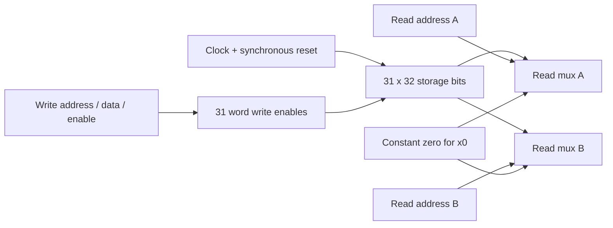

# M1, step 2: the register file

`rtl/core/regfile.sv` implements two independently addressed read ports and
one clocked write port for RV32I's architectural registers. The ALU and this
register file are separate tested blocks; the CPU still needs an immediate
generator, decoder, load/store unit and control FSM before executing programs.

The [RV32I programmer's model](https://docs.riscv.org/reference/isa/v20260120/unpriv/rv32.html#_programmers_model_for_base_integer_isa)
defines 32 registers of 32 bits, with x0 always zero. Our reset policy, number
of ports and write timing are microarchitecture choices, not additional ISA
requirements.

## Hardware contract

| Port | Behavior |
| --- | --- |
| `clk_i` | Writes/reset occur on its rising edge |
| `rst_i` | Active-high **synchronous** reset; clears x1–x31 at a rising edge; overrides writes |
| `we_i` | Allows a write when reset is low and the destination is nonzero |
| `waddr_i[4:0]`, `wdata_i[31:0]` | Destination and value sampled at the write edge |
| `raddr_a_i[4:0]`, `raddr_b_i[4:0]` | Independent read addresses |
| `rdata_a_o[31:0]`, `rdata_b_o[31:0]` | Combinational values of the selected registers; zero for x0 |

There is no ready/valid handshake: the enclosing CPU decides when to write.
There is no pre-edge write-through. If a read and a write address match, reads
show the stored old value before the rising edge and the new value after that
edge's nonblocking assignments settle. A disabled write cannot change state.
Asserting reset between rising edges leaves the old values visible until the
next rising edge. x0 is always zero, including before reset. Other registers
must be reset before their initial values are relied on.



## Read the RTL

The array is declared `regs[1:31]`: x0 has no writable storage. The write loop
describes 31 parallel hardware word enables. Its loop index is elaborated into
fixed register destinations; it is not a software loop that takes 31 cycles.
For each word, reset wins first; otherwise, an enabled matching write updates
that word; otherwise, its flip-flops retain their previous value.

This fixed-destination form also avoids a Yosys 0.33 inference issue observed
with a dynamically indexed write: the tool retained an additional unreachable
32-bit word. The final synthesis gate checks the intended **992 storage bits**
(31 x 32) rather than assuming the array declaration alone guarantees them.

`<=` schedules clocked state changes together. The continuous read assignments
select the stored word without waiting for another clock. Each output has an
explicit zero-address case. There is no read-output register or bypass path.
This makes a natural starting point for the planned multicycle core; a future
pipeline must define forwarding/stall behavior around its own stages.

This small bank deliberately uses flip-flops and read muxes. Resetting every
word and allowing asynchronous reads are not the BRAM style planned for the
larger instruction/data memory. Do not reuse this reset loop for the 64 KiB RAM.
ABI roles such as x1/return address and x2/stack pointer are software conventions;
they do not make those registers special in this circuit.

## Verification

`tests/unit/tb_regfile.sv` keeps a separate architectural scoreboard and checks
only public ports, never the DUT's array. It drives signals one time unit after
a falling edge, checks old state before the next rising edge, then checks the
committed state after the DUT's nonblocking updates. This avoids read/write
testbench races and detects accidental asynchronous writes or reset.

The directed sequence covers:

- Initial reset with a simultaneous write; x0 before the first reset edge.
- Writes to all addresses, including ignored x0 writes, followed by reading
  every register through both ports to detect aliasing/neighbor corruption.
- Disabled writes at all 32 destinations and same-address reads on both ports.
- Reset while a live register is nonzero, reset priority over write, held reset,
  and retention after reset release.
- Walking ones and zeros through every bit of x1–x31.
- All **1,024 combinations** of the two read addresses, using distinct register
  contents and checking outputs before any following rising edge.
- A final reset followed by inspection of every register.

The random phase adds **10,000 cycles**, varying write enable, destination,
data, both read addresses and reset. An explicit xorshift32 generator makes
the sequence reproducible; the default hexadecimal seed is `5eed1234`.
Failures report seed, checked cycle, phase, port, address and actual/expected
values. The scoreboard includes x0 and overwrites it with zero after every
modeled transaction; the DUT implements x0 by omitting storage. No uninitialized
nonzero register is checked before the first reset edge.

The default complete run performs **12,087 checked write/reset cycles** and
**54,558 port-value checks**. Address-only sweeps also consume simulation clocks
with writes disabled; they are counted in the read-check total, not in the
12,087 transaction count. These are directed/random functional checks, not an
exhaustive proof. Verilator's normal two-state behavior does not establish X/Z
propagation or physical setup/hold timing.

## Run and inspect

Inside Ubuntu, from the repository root:

```bash
make unit-regfile
make lint synth-regfile
make check
make wave-regfile
```

`make check` keeps the previous ALU and environment regression and adds this
register file. To vary the reproducible random stream:

```bash
make unit-regfile REGFILE_SEED=12345678 REGFILE_RANDOM_CYCLES=10000
```

`REGFILE_SEED` is interpreted as hexadecimal; it must be nonzero. Reducing the
random-cycle count helps debugging but does not meet the default acceptance
gate. `wave-regfile` generates a **limited 71-transaction sample**, then opens
GTKWave. The sample is explicitly labeled as limited and skips the long sweeps,
walking-bit and random phases.

Add `clk_i`, `rst_i`, `we_i`, `waddr_i`, `wdata_i`, both read addresses and both
read data signals. Look at x7 around the reset-with-write example: old data
remains visible after reset rises, then becomes zero on the rising clock edge.
Also inspect a write whose read address matches its destination to see old/new
data around the edge. Generated files are ignored under `build/regfile/`:
`obj/regfile_test`, `regfile.vcd`, `yosys.log` and `netlist.json`.

## Acceptance evidence

For this step, require warning-free lint, the complete directed/random run,
successful combined regression, and generic synthesis with zero check problems,
no inferred latches/asynchronous-reset flops, and exactly 992 single-bit storage
cells. Generic gate counts are not FPGA LUT counts or timing measurements.
The measured results for the final sources are included in the pull request.

Verified on 2026-10-22 with Ubuntu 24.04, Verilator 5.020 and Yosys 0.33:

| Check | Observed result |
| --- | --- |
| Warning-fatal lint | Passed for ALU and register file |
| Full register-file test | 12,087 checked transactions / 54,558 read checks passed |
| Independent read-address combinations | All 1,024 pairs checked before and after the random phase |
| Random phase | 10,000 cycles, seed `5eed1234` |
| Combined `make check` | Passed, including 168,728 ALU vectors and seven harness tests |
| Generic synthesis | 992 `$_SDFFE_PP0P_` storage cells, no latches or async reset; zero check problems |
| Total generic cells | 5,179, including storage; not an FPGA resource report |

The local combined regression log is `build/regfile/check.log`. FPGA
place/route, timing and physical execution remain future milestones.

The next independent module is the **immediate generator** for I/S/B/U/J
instruction formats. M1 remains in progress until that, the decoder and LSU
are independently verified as well.
