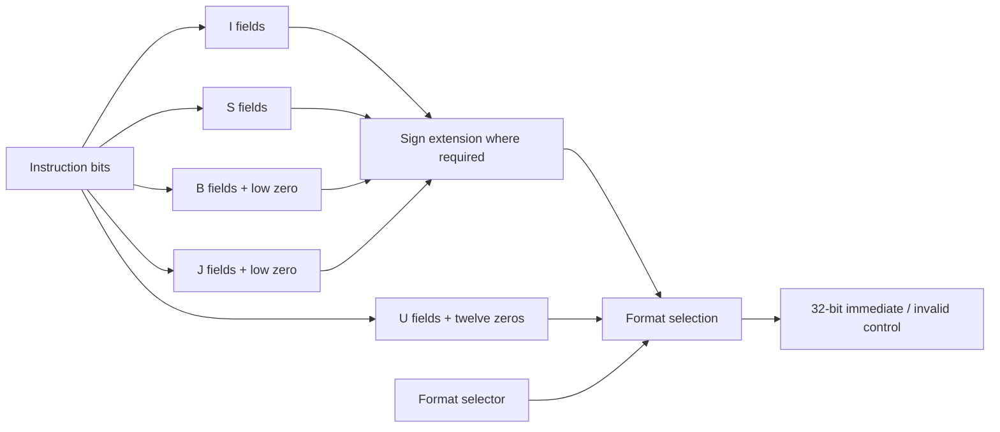

# M1, step 3: the immediate generator

`rtl/core/immediate.sv` reconstructs the immediate operand from a 32-bit
instruction and a format chosen by the future decoder. It is combinational:
no clock, reset or stored state. The ALU, register file and immediate generator
are now separate tested modules. The [decoder](11-instruction-decoder.md) is
also implemented; the load/store unit remains in M1.

The bit layouts follow the [RV32I base formats and immediate variants](https://docs.riscv.org/reference/isa/v20260120/unpriv/rv32.html#_immediate_encoding_variants).
Our selector values and invalid-control output are internal interface choices.

## Interface and bit mapping

| Signal | Meaning |
| --- | --- |
| `instr_i[31:0]` | Complete instruction word, including fields this format ignores |
| `format_i[2:0]` | Internal selector from `rv32_pkg.sv` |
| `imm_o[31:0]` | Reconstructed 32-bit operand/byte offset |
| `invalid_o` | One for unsupported selectors 6/7; otherwise zero |

`ins[n:m]` below means instruction bits, listed most significant first.
Sign extension copies instruction bit31 into the upper result bits for I/S/B/J.

| Selector | Format | Immediate before extension | Values |
| --- | --- | --- | --- |
| 0 | NONE | zero | For operations with no immediate |
| 1 | I | `ins[31:20]` | −2048 to +2047 |
| 2 | S | `ins[31:25], ins[11:7]` | −2048 to +2047 |
| 3 | B | `ins[31], ins[7], ins[30:25], ins[11:8], 0` | −4096 to +4094, steps of 2 bytes |
| 4 | U | `ins[31:12], twelve zero bits` | Upper 20-bit field placed into a 32-bit word |
| 5 | J | `ins[31], ins[19:12], ins[20], ins[30:21], 0` | −1048576 to +1048574, steps of 2 bytes |
| 6/7 | Unsupported | zero, invalid=1 | No stale result or latch |

These selector numbers are not instruction opcodes. A legal NONE selection
returns zero with invalid=0; it is distinct from an unsupported selector.
This block does not check opcode/funct3/funct7 or determine whether an
instruction is legal. Those responsibilities belong to the decoder.



## Read the implementation

Each `case` arm is explicit concatenation wiring. For B, the sign bit is
instruction bit31, but immediate bit11 comes from instruction bit7; the lower
bits come from two other slices. For J, bit20 is the sign, and immediate bit11
comes from instruction bit20. Naming the source bits explicitly makes those
two common wiring mistakes visible.

The repeated-bit expressions such as `{{20{instr_i[31]}}, instr_i[31:20]}`
copy the sign above the I field. A negative 12-bit immediate such as −1 must
become 0xffffffff, not 0x00000fff. U already produces a complete 32-bit pattern:
for example, an upper field of 0x80000 becomes 0x80000000.

Defaults assign both outputs; unsupported selectors therefore return zero and
invalid=1. All consumers share named control enums in `rv32_pkg.sv`, with the
existing ALU encodings preserved. Bit-vector module ports still permit tests
of unsupported controls. The simple enums are accepted by the tested Yosys
0.33 frontend and avoid unused exported-constant warnings during isolated lint.
The deliberately unused opcode bits have a named unused reduction; it creates
no output behavior and synthesis removes it. Other input bits stay linted.

## Rules for connecting this module later

- **Do not shift B/J a second time.** The output is already a signed byte offset.
  A +4 branch immediate is 4, not 2 or 8. Add it to the instruction's PC.
- A B/J offset may be 2 modulo 4. Extraction must preserve it. In this RV32I
  system, the CPU checks the final target's 4-byte alignment when the control
  transfer is taken; the immediate generator does not reject that offset.
- JALR uses an I immediate. Preserve its low bit here; clear bit0 of the final
  `rs1 + immediate` target in the CPU, then check alignment.
- SLTIU still needs a **sign-extended** I field before its unsigned comparison.
- SRAI's raw I field contains shift-control bits as well as shamt: shifting by
  31 has an I field of 0x41f. The decoder validates its encoding, and the ALU
  uses only the low five bits as the shift amount.
- LUI writes the U value; AUIPC adds it to the instruction PC. This module
  performs neither register writeback nor PC arithmetic.

## Independent verification

`scripts/gen_immediate_vectors.py` starts with logical immediate payloads and
**encodes** them into instruction words using position lists. Expected results
come from the original signed integer and a scale: 1 for I/S, 2 for B/J,
4096 for U. The oracle does not decode the constructed instruction, read RTL,
or copy the RTL's concatenations. Distinct ignored-field backgrounds must
produce the same expected output.

A second source is `tests/unit/immediate_cases.S`: GNU tools assemble/link
23 real instructions, and objcopy extracts their words. The test generator
uses independently listed expected operands and checks that the encoder agrees
with those actual words. Cases include negative loads/stores, SLTIU, SRAI,
JALR, branch/jump limits and U values with bit31 set. These fixture instructions
are inspected, **not executed**; some deliberately have targets that would be
misaligned under the project's execution environment.

The default seed is `0x1a2b3c4d`. The complete run contains:

| Group | Checks |
| --- | --- |
| GNU-assembled words | 23 |
| Directed vectors | 27,331, including all 4096 I/S/B payloads under two opposite backgrounds, literal words, walking bits and individual ignored-bit changes |
| Random vectors | 130,000: 10,000 payloads for each format under two backgrounds, plus NONE/invalid controls |
| Total | **157,354** |

`tests/unit/tb_immediate.sv` explicitly drives scanned values into the DUT,
waits for settling and compares both outputs. Failures report the vector row,
format, instruction and actual/expected results. The generator prints its
seed and saves the count/seed manifest. Full runs require all eight selector
values to be exercised. Empty/malformed input and timeouts fail.

Seven additional harness tests check that a good vector succeeds while wrong
sign extension, wrong invalid status, missing selector coverage and damaged
input are rejected. Verilator's normal two-state operation does not establish
X/Z behavior or physical timing; no exhaustive U/J-space proof is claimed.

## Run and inspect

Inside Ubuntu, from the repository root:

```bash
make unit-immediate
make lint synth-immediate
make check
make wave-immediate
```

To reproduce another stimulus stream:

```bash
make unit-immediate IMMEDIATE_SEED=0x12345678 IMMEDIATE_RANDOM_CASES=10000
```

`wave-immediate` generates a limited 256-vector sample, including all 23
assembled examples, then opens GTKWave. Display `format_i`, `instr_i`, `imm_o`,
`expected_immediate` and `invalid_o` in hexadecimal. Inspect the −4 branch and
jump cases and compare their different instruction words with the identical
0xfffffffc output. The limited waveform run is not the full acceptance test.

Ignored build evidence is under `build/immediate/`: `cases.elf`, `cases.bin`,
`cases.dis`, `vectors.txt`, `vectors.json`, `obj/immediate_test`, `immediate.vcd`,
`yosys.log` and `netlist.json`. The assembled fixture and RTL binary rebuild
when their relevant sources/Makefile change; vector generation reruns for each
test invocation, including seed changes.

## Acceptance

Require all default vectors and seven harness checks to pass, warning-fatal
lint for all three modules, the combined compiler/ALU/register-file regression,
and synthesis with no inferred state and zero check problems. Generic cell
counts are not FPGA LUT utilization or clock-frequency measurements. Measured
results are recorded in the pull request. No complete CPU or hardware execution
is claimed yet.

Verified on 2026-10-22 with Ubuntu 24.04, Verilator 5.020, Yosys 0.33 and
RISC-V GCC 13.2.0/binutils 2.42:

| Check | Observed result |
| --- | --- |
| Complete immediate vectors | 157,354 passed, seed `0x1a2b3c4d` |
| GNU assembler fixtures | All 23 linked instruction words agreed with the encoder and RTL |
| Immediate harness | All seven tests passed, including six rejection cases |
| Combined `make check` | Passed, including all prior ALU/register-file/compiler checks |
| Warning-fatal lint | Passed for all three datapath modules |
| Generic synthesis | Zero check problems; 220 combinational cells; no latches or flip-flops |

The local combined regression log is `build/immediate/check.log`.

The following [decoder step](11-instruction-decoder.md) now validates full RV32I
encodings and generates safe datapath controls. The next module is the LSU.
